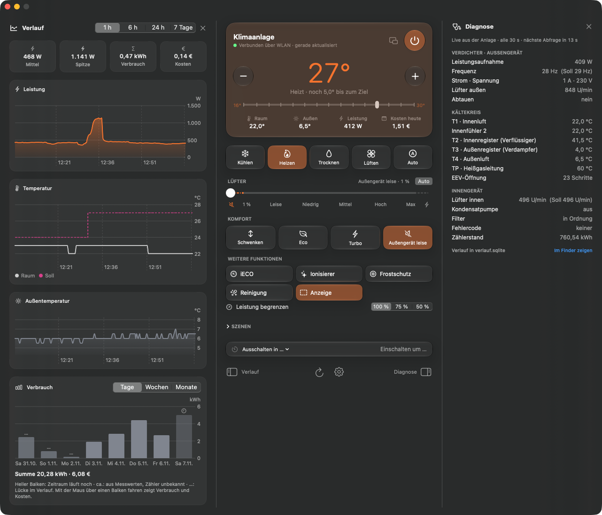
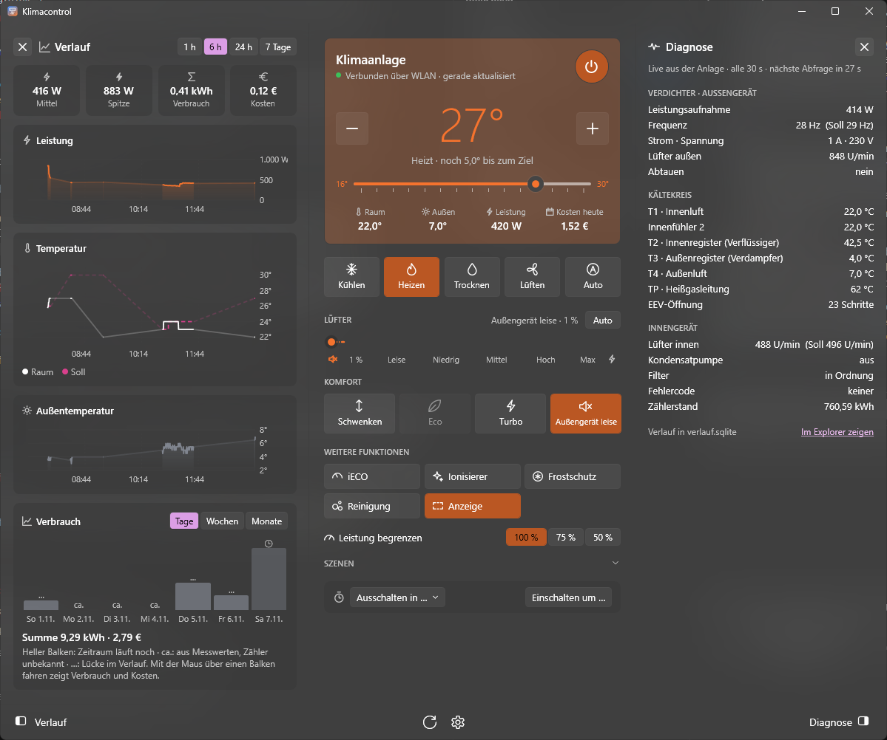

# Klimacontrol

**Native Steuerung für Midea-PortaSplit-Klimaanlagen unter macOS und Windows – lokal im LAN über das Midea-Protokoll
V3, Cloud-Zugriff optional.**

<p align="center">
  <a href="https://github.com/mlafx/Klimacontrol/releases/latest/download/Klimacontrol-mac.dmg"></a><br>
  <a href="https://github.com/mlafx/Klimacontrol/releases/latest/download/Klimacontrol-Windows-Setup.exe"></a>
</p>

<p align="center">
  <a href="#funktionen"></a>
  
  
</p>

<p align="center">
  <a href="LICENSE"></a>
  
</p>

[Überblick](#überblick) · [Funktionen](#funktionen) · [Voraussetzungen](#voraussetzungen) ·
[Installation](#installation) · [Einrichtung](#einrichtung) · [Betriebshinweise](#betriebshinweise) ·
[Entwicklung](#entwicklung)

**macOS**



<details>
<summary><b>Windows</b></summary>



</details>

## Überblick

Klimacontrol kommuniziert direkt mit der Anlage im lokalen Netzwerk (Midea-Protokoll V3 „8370“, TCP 6444,
AES-verschlüsselt). Die Midea-Cloud (MSmartHome bzw. NetHome Plus) wird ausschließlich für den Fernzugriff und das
einmalige Abrufen von Token und Schlüssel verwendet. Im Modus „Automatisch“ wird lokal gesteuert und bei
Nichterreichbarkeit auf die Cloud ausgewichen.

Beide Plattformen nutzen denselben Kern in Swift; die Oberflächen sind nativ umgesetzt (SwiftUI unter macOS, WPF unter
Windows).

## Funktionen

| Bereich | Umfang |
|---|---|
| Bedienung | Ein/Aus, Kühlen, Heizen, Trocknen, Lüften, Auto; Solltemperatur 16–30 °C; Lüfter stufenlos 1–100 % |
| Zusatzfunktionen | Schwenken, Eco, Turbo, Außengerät leise, iECO, Ionisierer, Frostschutz, Selbstreinigung, Leistungsbegrenzung |
| Timer und Szenen | Ein- und Ausschalt-Timer, gespeicherte Szenen |
| Verlauf | Leistung, Temperaturen, Verbrauch und Kosten je Tag, Woche und Monat; Export als CSV |
| Diagnose | Verdichter, Kältekreis, Lüfter, Filterstatus und Fehlercodes live aus der Anlage |
| Integration | Menüleiste (macOS) bzw. Infobereich (Windows), Mini-Fenster, Start bei der Anmeldung |
| Darstellung | Hell, dunkel und mehrere Themen; Transparenz, Größe und Umfang einstellbar |
| Sprachen | Deutsch und Englisch; nach Systemsprache oder in den Einstellungen wählbar; Zahlen, Uhrzeit und Datum nach den Regionseinstellungen |
| Updates | Signiert (EdDSA) und automatisch; macOS installiert selbstständig, Windows nach Bestätigung |

## Voraussetzungen

- Midea PortaSplit im selben lokalen Netzwerk wie der Rechner; UDP 6445/20086 (Suche) und TCP 6444 (Steuerung) müssen
  erreichbar sein. Andere Midea-Anlagen mit Protokoll V3 sind voraussichtlich kompatibel, aber nicht getestet.
- macOS 15 oder neuer (Apple Silicon und Intel) bzw. Windows 10 oder neuer (x64)
- Midea-Konto (MSmartHome oder NetHome Plus) **oder** Token und Schlüssel der Anlage

## Installation

Die Knöpfe oben laden immer die neueste Fassung. Alle Pakete, auch mit Versionsnummer im Namen, stehen unter
[Releases](https://github.com/mlafx/Klimacontrol/releases/latest) bereit.

| Plattform | Paket | Hinweise |
|---|---|---|
| macOS | `Klimacontrol-mac.dmg` bzw. `Klimacontrol-<Version>-mac.dmg` | Klimacontrol in „Programme“ ziehen; den Zugriff auf das lokale Netzwerk erlauben, andernfalls wird die Anlage nicht gefunden. |
| Windows | `Klimacontrol-Windows-Setup.exe` bzw. `Klimacontrol-Windows-<Version>-Setup.exe` | Installation ohne Administratorrechte. Den Netzwerkzugriff für **private** Netzwerke in der Firewall freigeben. |

> [!NOTE]
> Beim ersten Start des aus dem Browser geladenen Windows-Setups zeigt Windows einen Sicherheitshinweis (SmartScreen
> „Der Computer wurde durch Windows geschützt“ mit „Weitere Informationen“ → „Trotzdem ausführen“, oder „Unbekannter
> Herausgeber“ mit „Ausführen“). Updates über die App zeigen ihn nicht. Updates werden unabhängig davon per EdDSA-Signatur geprüft.

## Einrichtung

Beim ersten Start führt ein Assistent durch die Einrichtung:

1. **Mit Midea-Konto (empfohlen):** Die Anlage wird per Broadcast im lokalen Netzwerk gefunden; Token und Schlüssel
   werden einmalig aus der Cloud abgerufen und an der Anlage geprüft. Die Steuerung erfolgt anschließend lokal.
2. **Ohne Midea-Konto:** Token und Schlüssel manuell eingeben oder eine vorhandene Sicherung einlesen.

> [!TIP]
> Nach der Einrichtung empfiehlt sich eine Sicherung der Zugangsdaten unter **Einstellungen → Anlage → „Zugangsdaten
> sichern …“**. Die Datei ermöglicht die Steuerung der Anlage und gehört nicht in einen Cloud-Ordner.

## Betriebshinweise

- **Eine Verbindung gleichzeitig:** Die Anlage akzeptiert nur eine lokale Verbindung. Die Meldung „Anlage belegt“
  bedeutet in der Regel, dass die Midea-App oder ein zweiter Rechner gerade verbunden ist.
- **Geänderte IP-Adresse** (z. B. nach einem Routerwechsel): **Einstellungen → Anlage → „Adresse neu suchen“**; eine
  neue Einrichtung ist nicht erforderlich.
- **Timer** werden von der App ausgeführt, nicht von der Anlage. Sie greifen nur, solange Klimacontrol läuft und der
  Rechner nicht im Ruhezustand ist; „Beim Anmelden starten“ ist standardmäßig aktiv.
- **Datenschutz:** Zugangsdaten und Verlauf werden ausschließlich lokal im Benutzerprofil gespeichert, die Sitzung
  des Midea-Kontos im Schlüsselbund (macOS) bzw. in der Anmeldeinformationsverwaltung (Windows). Verbindungen zu Midea
  entstehen nur bei eingerichtetem Midea-Konto.

## Entwicklung

**macOS** – Xcode 27 (Swift 6.4):

```bash
tools/test.sh          # Tests
tools/build_app.sh     # App bauen; DMG und ZIP landen in dist/mac/
```

**Windows** – Visual Studio Build Tools (C++), Swift 6.4 für Windows, .NET 10 SDK:

```powershell
powershell -ExecutionPolicy Bypass -File tools\build_windows.ps1 -App
```

Architektur, Bridge-Vertrag, Testkonzept und Release-Ablauf sind in [AGENTS.md](AGENTS.md) beschrieben.

## Lizenz und Hinweise

Klimacontrol steht unter der [MIT-Lizenz](LICENSE). Die Protokollimplementierung basiert auf
[msmart-ng](https://github.com/mill1000/midea-msmart),
[midea-beautiful-air](https://github.com/nbogojevic/midea-beautiful-air) und
[midea_ac_lan](https://github.com/georgezhao2010/midea_ac_lan); vielen Dank an alle Beteiligten. Updates werden über
[Sparkle](https://sparkle-project.org) und [WinSparkle](https://winsparkle.org) verteilt. Sämtliche Lizenzhinweise
stehen in [docs/THIRD_PARTY_NOTICES.md](docs/THIRD_PARTY_NOTICES.md).

Klimacontrol ist ein privates Projekt und kein Produkt von Midea. Midea, MSmartHome, NetHome Plus und PortaSplit sind
Marken ihrer jeweiligen Inhaber. Nutzung auf eigene Verantwortung.
